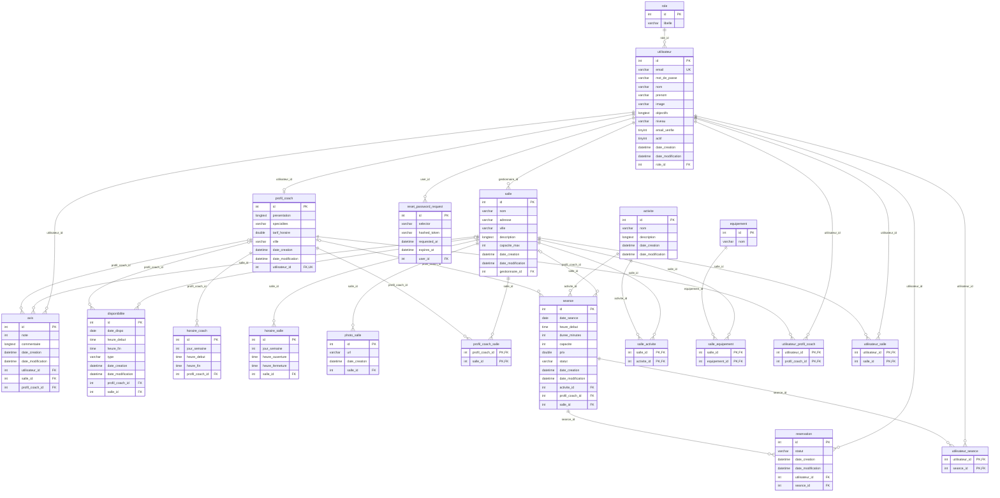

# Modèle logique de données (MLD) — FitBook

Modèle relationnel déduit du schéma réel de la base MySQL `fitbook` (migrations Doctrine).

Notation : <u>clé primaire</u> soulignée, `#clé_étrangère` précédée d'un dièse (avec la table référencée), `(NULL)` pour une colonne facultative, `(unique)` pour une valeur unique.

## Schéma relationnel

| Table | Colonnes |
|---|---|
| **activite** | <u>id</u>, nom, description (NULL), date_creation, date_modification |
| **avis** | <u>id</u>, note, commentaire (NULL), date_creation, date_modification, #utilisateur_id → utilisateur, #salle_id → salle (NULL), #profil_coach_id → profil_coach (NULL) |
| **disponibilite** | <u>id</u>, date_dispo, heure_debut, heure_fin, type, date_creation, date_modification, #profil_coach_id → profil_coach (NULL), #salle_id → salle (NULL) |
| **equipement** | <u>id</u>, nom |
| **horaire_coach** | <u>id</u>, jour_semaine, heure_debut, heure_fin, #profil_coach_id → profil_coach |
| **horaire_salle** | <u>id</u>, jour_semaine, heure_ouverture, heure_fermeture, #salle_id → salle |
| **photo_salle** | <u>id</u>, url, date_creation, #salle_id → salle |
| **profil_coach** | <u>id</u>, presentation, specialites, tarif_horaire, ville, date_creation, date_modification, #utilisateur_id → utilisateur (unique) |
| **profil_coach_salle** | <u>#profil_coach_id</u> → profil_coach, <u>#salle_id</u> → salle |
| **reservation** | <u>id</u>, statut, date_creation, date_modification, #utilisateur_id → utilisateur, #seance_id → seance |
| **reset_password_request** | <u>id</u>, selector, hashed_token, requested_at, expires_at, #user_id → utilisateur |
| **role** | <u>id</u>, libelle |
| **salle** | <u>id</u>, nom, adresse, ville, description, capacite_max, date_creation, date_modification, #gestionnaire_id → utilisateur |
| **salle_activite** | <u>#salle_id</u> → salle, <u>#activite_id</u> → activite |
| **salle_equipement** | <u>#salle_id</u> → salle, <u>#equipement_id</u> → equipement |
| **seance** | <u>id</u>, date_seance, heure_debut, duree_minutes, capacite, prix, statut, date_creation, date_modification, #activite_id → activite, #profil_coach_id → profil_coach (NULL), #salle_id → salle (NULL) |
| **utilisateur** | <u>id</u>, email (unique), mot_de_passe, nom, prenom, image (NULL), objectifs (NULL), niveau (NULL), email_verifie, actif, date_creation, date_modification, #role_id → role |
| **utilisateur_profil_coach** | <u>#utilisateur_id</u> → utilisateur, <u>#profil_coach_id</u> → profil_coach |
| **utilisateur_salle** | <u>#utilisateur_id</u> → utilisateur, <u>#salle_id</u> → salle |
| **utilisateur_seance** | <u>#utilisateur_id</u> → utilisateur, <u>#seance_id</u> → seance |

## Tables d'association (relations plusieurs-à-plusieurs)

- `profil_coach_salle` : salles où intervient un coach.
- `salle_activite` : activités proposées par une salle.
- `salle_equipement` : équipements d'une salle.
- `utilisateur_salle` : salles favorites d'un utilisateur.
- `utilisateur_profil_coach` : coachs favoris d'un utilisateur.
- `utilisateur_seance` : séances favorites d'un utilisateur.

La table technique `doctrine_migration_versions` (suivi des migrations) n'est pas représentée.

## Diagramme

